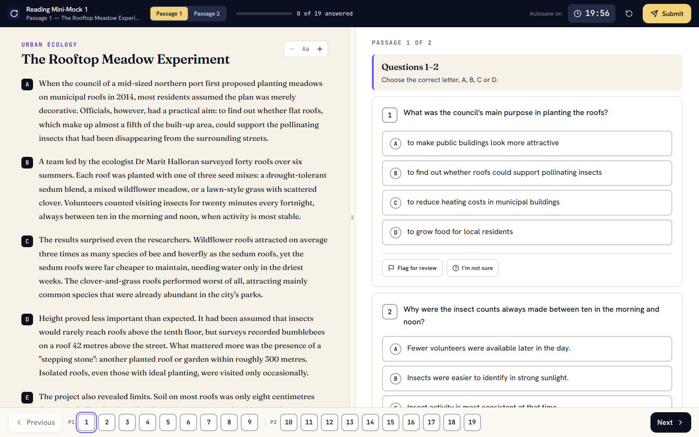

# Reading exam interface

The exam screen (`/attempts/:id`) is a full-viewport workspace, deliberately separate from the rest of the site.
It reuses the existing engine, runner (`useAttemptRunner`: server-authoritative timer, autosave, submit) and services; the redesign is presentation
and interaction only. No answer data reaches the browser before submission (unchanged and re-tested).



## Layout

| Region | Behaviour |
|---|---|
| **Toolbar** (always visible) | Test name · current passage · **Passage 1 / 2** switch · progress bar + "N of 19 answered" (+ flagged count) · save status · **timer** · reset-layout · **Submit**. One element tree that reflows on phones (two compact rows). |
| **Passage pane** (left) | Title, labelled paragraphs (A–E), serif body text with comfortable measure and line height, **A− / A+** text size (remembered). |
| **Questions pane** (right) | Grouped questions with the group heading and instructions; one card per question showing number, answered ✓ / flagged ⚑ state, the control, and *Flag for review* / *I'm not sure*. |
| **Divider** | Drag (mouse / touch / pen), or focus it and use **←/→** (2 %), **Home/End** (limits), **Enter** or double-click or the toolbar button to reset. Each pane has a **340 px minimum**; the layout is remembered. |
| **Footer** | **Previous / Next question** and a numbered **palette** in one scrollable row. States use fill + icon + accessible name ("Question 6: answered, flagged for review"), never colour alone. |
| **Phone / tablet (< 1024 px)** | No squeezed columns: **Passage ⇄ Questions** tabs; both panes stay mounted so scroll positions and answers survive switching. |

Each pane is its own scroll container, so scrolling questions never moves the passage. The page itself never scrolls.

## Answer controls

| Type | Control |
|---|---|
| Multiple choice | Four selectable option rows with letter badges |
| True / False / Not Given | Three equal, distinct choices |
| Sentence / summary completion | A **bordered field inside the sentence at the blank** ("Type answer", dashed while empty, solid when filled; grows as you type), with the word limit and a live `0/1` counter directly beneath. Over-limit shows a warning. |
| Short answer | Full-width text field with the same limit chip |
| Choose two | Checkboxes; the required count is stated ("Choose TWO answers · 1 of 2 selected"); extra boxes lock at the limit |
| Matching information | Paragraph letters A–E |

All are native inputs with labels (keyboard and screen-reader friendly) and are fully controlled by the saved draft.

## Timer, warnings, submission
* **One timer only**: the server deadline from the runner. The chip is `role="timer"` (no per-second announcements), changes colour **and** icon/words at 5 min and 1 min, and has no animation. A dismissible banner appears under 5 minutes and states how many questions are unanswered. At zero the *existing* rules submit the attempt as time-expired.
* **Submit** always opens a confirmation listing **unanswered / flagged / unsure** question numbers as buttons that jump to them, plus **Review unanswered**, **Keep working** and **Submit final answers**. Nothing is submitted until confirmed; double-clicks are safe (server-side idempotent).

## Verifying it

```powershell
npm.cmd run verify          # typecheck + all Vitest suites (incl. src/test/exam-ui.test.tsx) + build
```

**Real-browser check** (layout, independent scrolling, divider drag, answer entry, navigation, dialog, timer — 6 viewports from 1440×900 down to 360×640).
It uses a browser you already have; nothing is downloaded.

```powershell
npm.cmd run dev                                   # terminal 1  (http://localhost:5173)
# terminal 2 — pick ONE browser path:
$env:CHROME_PATH = "C:\Program Files\Google\Chrome\Application\chrome.exe"
# $env:CHROME_PATH = "C:\Program Files (x86)\Microsoft\Edge\Application\msedge.exe"
npm.cmd run check:browser                         # prints PASS/FAIL per check; screenshots → .\browser-check-output\
```
(The Windows invocation above has **not** been run by the author — the checks were run with headless Chromium 131 on Linux.)

## Known limits
No passage text highlighting (official computer exams offer it), no per-question notes, no on-screen calculator/clock beyond the timer. The two-column workspace needs ≥ 1024 px; narrower screens use tabs by design.
